# Сдача спринта 2

По какой-то причине пакеты не отображаются в GitHub, если смотреть со стороннего аккаунта, но с моего аккаунта их видно.

Включение отображение Deploymets (Edit repository details -> Deployments) просто не сохраняется, так и не смог победить это.

Тем не менее пакеты доступны по ссылкам:

* [architecture-pro-cinemaabyss/Fmonolith](https://github.com/0xkillaflow/architecture-pro-cinemaabyss/pkgs/container/architecture-pro-cinemaabyss%2Fmonolith)
* [architecture-pro-cinemaabyss/movies-service](https://github.com/0xkillaflow/architecture-pro-cinemaabyss/pkgs/container/architecture-pro-cinemaabyss%2Fmovies-service)
* [architecture-pro-cinemaabyss/events-service](https://github.com/0xkillaflow/architecture-pro-cinemaabyss/pkgs/container/architecture-pro-cinemaabyss%2Fevents-service)
* [architecture-pro-cinemaabyss/proxy-service](https://github.com/0xkillaflow/architecture-pro-cinemaabyss/pkgs/container/architecture-pro-cinemaabyss%2Fproxy-service)

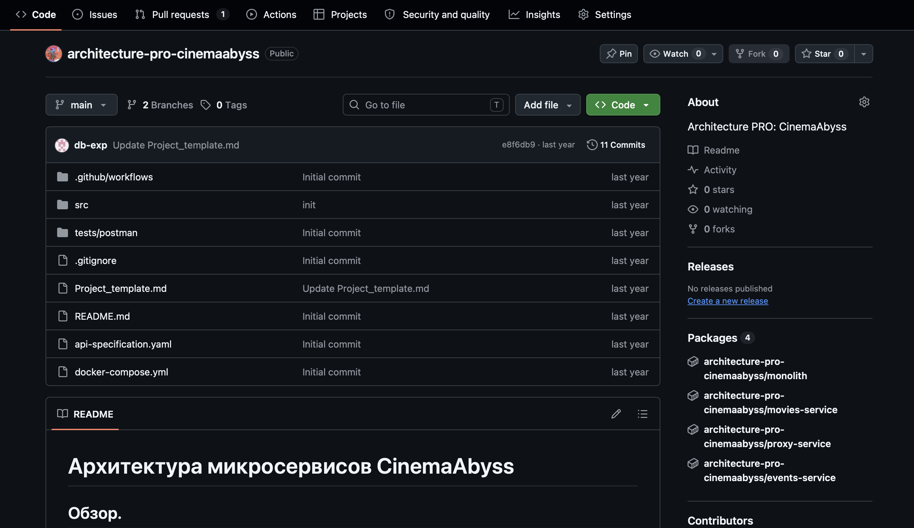

## Задание 1. To-Be архитектура

Спроектировал целевую архитектуру «Кинобездны»: разделил систему на домены, сделал единую точку входа для клиентов и асинхронное взаимодействие сервисов через Kafka. Диаграмма контейнеров в C4: [containers-to-be.puml](schemas/c4/containers-to-be.puml) ([png](schemas/c4/containers-to-be.png)).

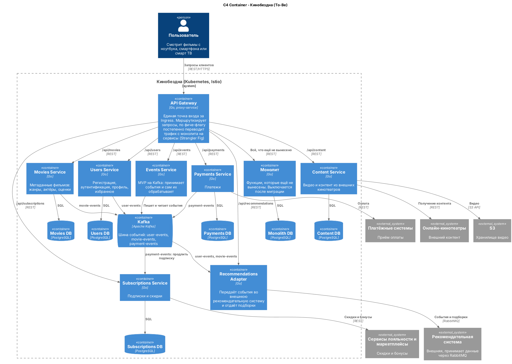

**Домены**

- **Пользователи** - регистрация, аутентификация, профиль, избранное. Нужны всем остальным и меняются отдельно от них.
- **Каталог** - метаданные фильмов: жанры, актёры, оценки. Самая нагруженная на чтение часть, её проще всего масштабировать отдельно. Уже выделен.
- **Контент** - видео в S3 и контент из внешних онлайн-кинотеатров. Свои интеграции, своё хранилище и свой профиль нагрузки.
- **Подписки и скидки** - правила доступа к контенту и интеграции с сервисами лояльности. Их часто меняет маркетинг, поэтому они отдельно от платежей.
- **Платежи** - работа с платёжными системами. Тут повышенные требования к надёжности, и сбой платежей не должен ронять каталог.
- **Рекомендации** - внешняя система, у нас только адаптер.

**Интеграция**

- Единая точка входа - API Gateway (proxy-service) за Ingress. Все клиенты (веб, мобильные, смарт ТВ) ходят только в него по REST. Разный объём данных для разных устройств отдаётся через параметры запросов к тому же API.
- Пока идёт миграция, API Gateway по фиче-флагу постепенно переводит трафик с монолита на новые сервисы (Strangler Fig). Когда всё вынесено, монолит выключается.
- У каждого сервиса своя база данных.
- Между собой сервисы общаются асинхронно через Kafka: например, после успешной оплаты Payments Service пишет событие в payment-events, а Subscriptions Service по нему продлевает подписку. Синхронно (REST) работают только запросы клиентов.
- Recommendations Adapter читает события из Kafka и передаёт их во внешнюю рекомендательную систему через её RabbitMQ.
- Всё развёрнуто в Kubernetes, Istio даёт Circuit Breaker и канареечные релизы.

## Задание 2. Proxy и Kafka

### Proxy (через Strangler Fig)

Реализовал прокси-сервис [src/microservices/proxy](src/microservices/proxy) на Go. Он работает как API Gateway и постепенно переключает трафик с монолита на сервис movies по фиче-флагу:

- `/api/movies` при `GRADUAL_MIGRATION=true` с вероятностью `MOVIES_MIGRATION_PERCENT` процентов уходит в movies-service, иначе в монолит;
- `/api/events/*` уходит в events-service;
- всё остальное пока идёт в монолит;
- куда ушёл каждый запрос, видно в логе proxy.

Проверял, меняя `MOVIES_MIGRATION_PERCENT` в `docker-compose.yml`: при `0` все запросы идут в монолит, при `100` все в movies-service, при `50` примерно поровну

### Events (Kafka)

Сделал MVP-сервис [src/microservices/events](src/microservices/events) на Go

- `POST /api/events/movie`, `/api/events/user`, `/api/events/payment` пишут событие в топик `movie-events`, `user-events` или `payment-events`;
- consumer в этом же сервисе читает все три топика и пишет события в лог.

Немного фиксанул, в `docker-compose.yml` сервисы теперь ждут готовности Postgres и перезапускаются при падении. Раньше монолит и movies иногда стартовали раньше БД и сразу завершались из-за того что БД еще не стартанула

Запуск:

```bash
docker compose up -d --build
cd tests/postman
docker build -t cinemaabyss-api-tests .
docker run --rm --network=cinemaabyss-network cinemaabyss-api-tests
```

Тесты:

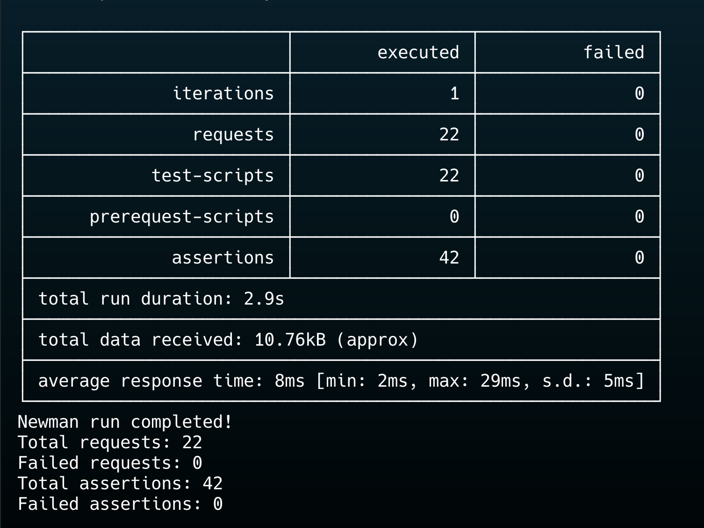

Топики в Kafka UI (http://localhost:8090):

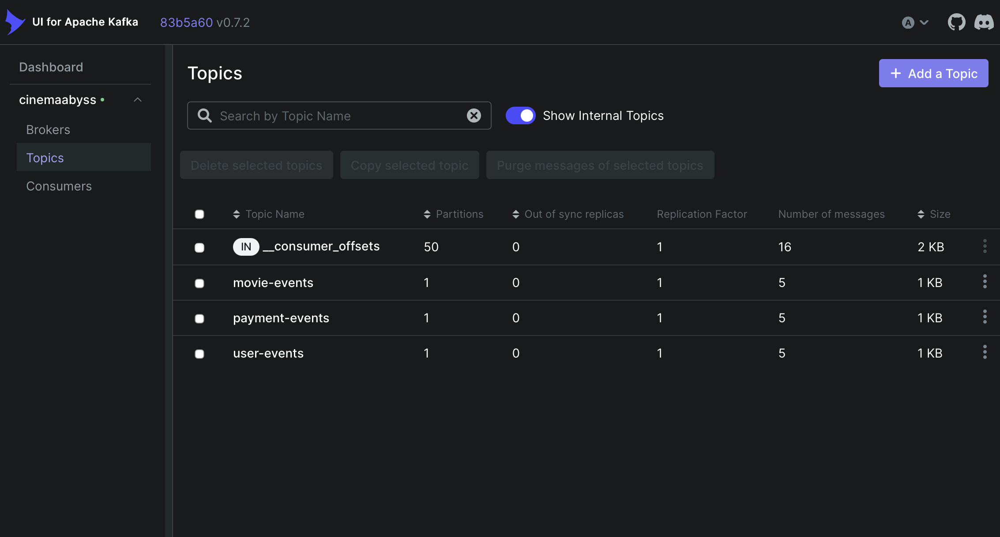

## Задание 3. CI/CD и Kubernetes

### CI/CD

- В [docker-build-push.yml](.github/workflows/docker-build-push.yml) добавил сборку и публикацию образов events-service и proxy-service в GitHub Registry и запуск на ветке `cinema`. Образы собираются под amd64 и arm64 (т.к тестил под M4)
- В [api-tests.yml](.github/workflows/api-tests.yml) добавил запуск тестов на ветке `cinema`.

### Kubernetes

- Описал Deployment и Service для [proxy-service](src/kubernetes/proxy-service.yaml) и [events-service](src/kubernetes/events-service.yaml)
- В [ingress.yaml](src/kubernetes/ingress.yaml) `/api/events` идёт в events-service, всё остальное в proxy-service
- В [configmap.yaml](src/kubernetes/configmap.yaml) добавил `EVENTS_SERVICE_URL` и `KAFKA_BROKERS`, во всех манифестах прописал свои образы

Ответ https://cinemaabyss.example.com/api/movies:

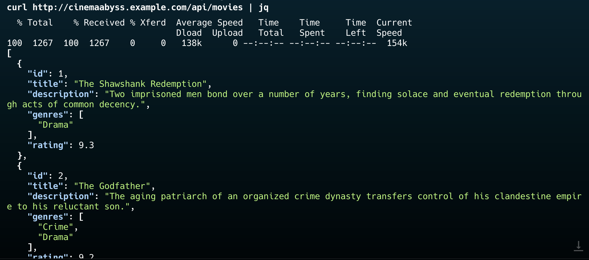

Логи events-service после тестов:

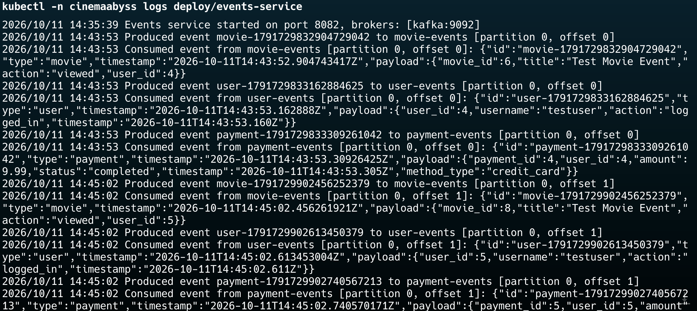

## Задание 4. Helm

Заполнил шаблоны [proxy-service.yaml](src/kubernetes/helm/templates/services/proxy-service.yaml) и [events-service.yaml](src/kubernetes/helm/templates/services/events-service.yaml), в [values.yaml](src/kubernetes/helm/values.yaml) указал свои образы и секрет для доступа к ним. В [configmap.yaml](src/kubernetes/helm/templates/configmap.yaml) исправил адрес movies-service (был `movies`) и добавил `EVENTS_SERVICE_URL` и `KAFKA_BROKERS`.

Установка:

```bash
helm install cinemaabyss ./src/kubernetes/helm --namespace cinemaabyss --create-namespace
```

Установка и поды:

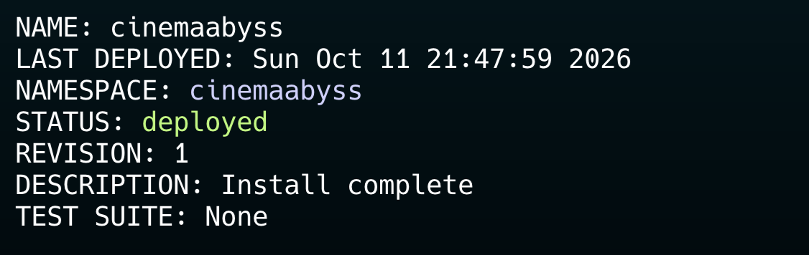
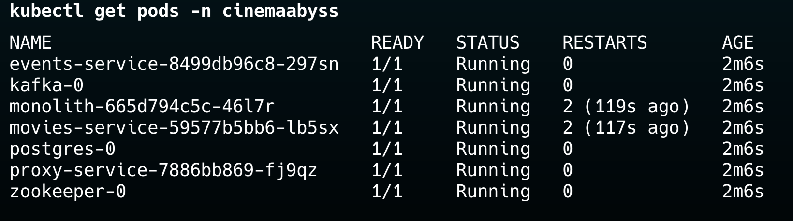

Ответ https://cinemaabyss.example.com/api/movies:

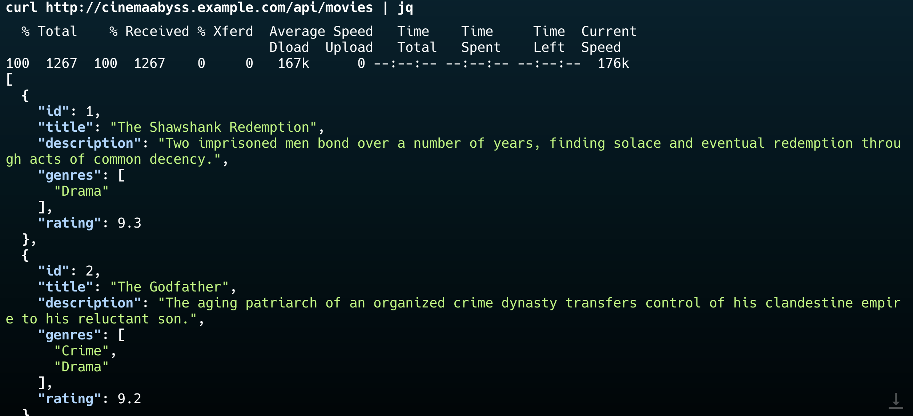

## Задание 5. Istio и Circuit Breaker

Развернул Istio и настроил Circuit Breaker для monolith и movies-service в [circuit-breaker-config.yaml](src/kubernetes/circuit-breaker-config.yaml). Лимиты специально маленькие (одно соединение и один запрос в очереди), чтобы срабатывание было хорошо видно на тесте. После первого ответа 5xx под исключается из балансировки на 3 минуты.

```bash
kubectl label namespace cinemaabyss istio-injection=enabled --overwrite
kubectl -n cinemaabyss rollout restart deployment
kubectl apply -f src/kubernetes/circuit-breaker-config.yaml -n cinemaabyss
```

Нагрузка через fortio, много ответов 503 от Circuit Breaker:

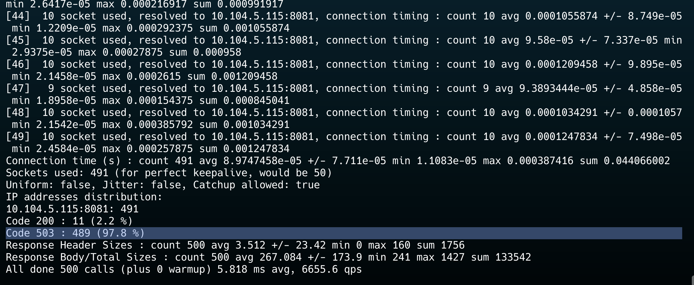

Статистика, `upstream_rq_pending_overflow` показывает число отсечённых запросов:

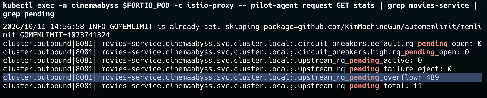
